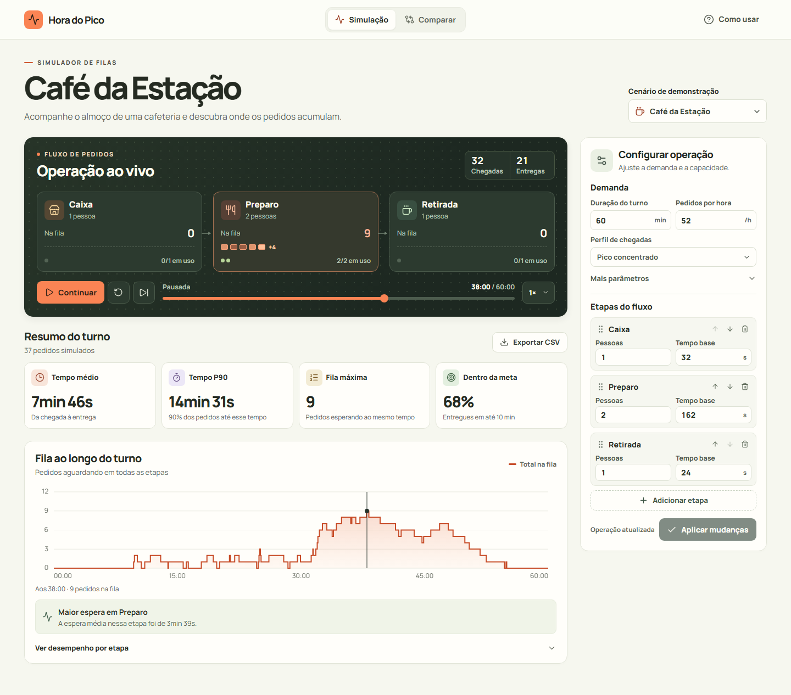
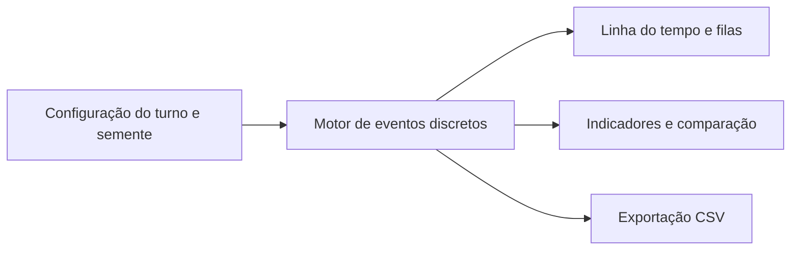

# Hora do Pico

[](https://github.com/cezarnovaes/hora-do-pico/actions/workflows/ci.yml)

Simulador interativo de filas para testar mudanças em uma operação. Se os pedidos acumulam no horário do almoço, vale colocar mais uma pessoa no caixa ou no preparo? Monte um turno e compare o efeito de cada mudança usando a mesma sequência de pedidos.



[Comparação de cenários](docs/imagens/comparacao.png) · [Interface no celular](docs/imagens/celular.png) · [Roteiro de apresentação](docs/apresentacao.md)

## Funcionalidades

- **Acompanhe a operação.** Reproduza o turno, pause ou mova a linha do tempo para ver quantos pedidos aguardam e quantas pessoas estão ocupadas em cada etapa.
- **Monte seu cenário.** Comece pela cafeteria, pelo food truck ou pela cantina. Ajuste chegadas, capacidade, tempo de atendimento e ordem das etapas.
- **Compare alternativas.** Fixe uma referência e veja as diferenças de tempo, fila e meta de entrega. O gráfico sobrepõe a evolução das duas filas minuto a minuto.
- **Exporte os resultados.** O CSV traz uma linha por passagem de um pedido por uma etapa, com os horários e a espera em segundos.

## Rodar na sua máquina

Com Node.js 24 e npm instalados, execute os comandos abaixo.

```sh
git clone https://github.com/cezarnovaes/hora-do-pico.git
cd hora-do-pico
npm ci
npm run dev
```

Abra [http://127.0.0.1:5173](http://127.0.0.1:5173). No PowerShell, use `npm.cmd` se a execução de `npm.ps1` estiver bloqueada.

## Teste uma mudança em dois minutos

1. Abra **Café da Estação**. Inicie a reprodução ou arraste a linha do tempo até **38:00** para encontrar a fila de nove pedidos no preparo.
2. Em **Comparar**, clique em **Fixar cenário atual**.
3. Volte para **Simulação**, aumente o preparo de duas para três pessoas e clique em **Aplicar mudanças**.
4. Abra **Comparar** e consulte a tabela e o gráfico. Os dois turnos recebem os mesmos 37 pedidos.

| Indicador | Duas pessoas no preparo | Três pessoas no preparo |
| --- | ---: | ---: |
| Tempo médio da chegada à entrega | 7min 46s | 4min 54s |
| Tempo P90 | 14min 31s | 8min 06s |
| Maior fila simultânea | 9 | 6 |
| Pedidos entregues em até 10 min | 25/37 (67,6%) | 37/37 (100%) |

## Como a simulação funciona

- **Chegadas.** O motor sorteia uma possível chegada a cada segundo antes do fechamento. O perfil distribui a intensidade ao longo do turno. Pedidos por hora define a taxa esperada e o total de pedidos realizado varia com a semente.
- **Atendimento.** Todos os pedidos passam pelas etapas na ordem configurada. Cada pessoa atende um pedido por vez. O tamanho do pedido e uma variação determinística alteram o tempo base de cada atendimento. A fila é servida por chegada ou por tamanho do pedido. Em caso de empate, vale a ordem de entrada na etapa. Um atendimento em andamento termina normalmente.
- **Eventos.** O motor avança para a próxima chegada ou conclusão. Para eventos simultâneos, finaliza os atendimentos, encaminha os pedidos e só então inicia novos atendimentos. O turno continua até concluir os pedidos já recebidos. A reprodução percorre os eventos calculados.
- **Comparação.** A janela de chegadas, a meta e a sequência de horários e tamanhos precisam coincidir para calcular as diferenças. A duração de serviço de um pedido numa etapa existente permanece reproduzível ao mudar apenas a capacidade.
- **Métricas.** O tempo médio usa todos os pedidos do turno. O P90 usa o valor na posição `ceil(0,90 × n)` dos tempos ordenados. A fila máxima soma pedidos esperando nas etapas no mesmo instante. A ocupação divide os segundos ocupados pelos segundos de capacidade total da etapa até o fim do turno.

O modelo usa dados sintéticos, rotas lineares e capacidade fixa durante cada turno. Os resultados descrevem a simulação. Para extrapolar para uma operação real, é preciso medir chegadas e atendimento e calibrar o modelo.

## Arquitetura

A aplicação roda no navegador. O motor em JavaScript calcula o turno completo, a interface reproduz a linha do tempo e o Vite gera o build estático. As configurações aplicadas e a referência ficam salvas no navegador.



- [`src/simulation.js`](src/simulation.js) contém o motor de eventos discretos. Ele roda também no Node e é independente da interface.
- [`src/scenarios.js`](src/scenarios.js) contém os dados de demonstração e valida os limites de entrada.
- [`src/app.js`](src/app.js), [`src/views.js`](src/views.js) e [`src/chart.js`](src/chart.js) ligam o editor, o player, as métricas e a comparação ao navegador.
- [`src/storage.js`](src/storage.js) salva as configurações localmente, sem conta ou API externa.

## Testes e build

```sh
npm test
npm run build
npx playwright install chromium firefox
npm run test:e2e
```

O [GitHub Actions](.github/workflows/ci.yml) executa os testes do motor e as jornadas em Chromium e Firefox contra o build de produção. As verificações automatizadas de acessibilidade cobrem simulação, guia e comparação. Em Linux, acrescente `--with-deps` ao comando de instalação dos navegadores para incluir as dependências do sistema.

Depois do build, use `npm run preview` para conferir a versão de produção localmente ou `npm run screenshots` para reproduzir as capturas.
